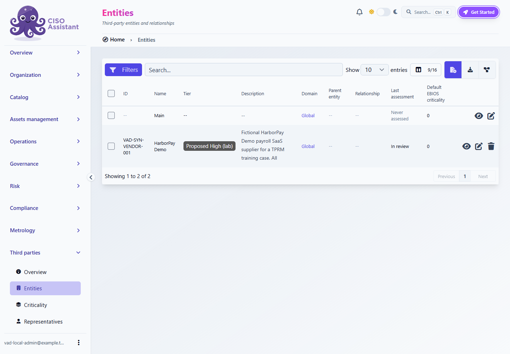

# Vendor Assurance Desk

**[Open the live dashboard](https://dedsec-terminal.github.io/Vendor-Assurance-Desk/) · [Read the due-diligence case](https://dedsec-terminal.github.io/Vendor-Assurance-Desk/site/review/) · [Follow the walkthrough](docs/demo_walkthrough.md)**

A practical third-party cyber-risk case study: decide whether a fictional payroll supplier can be onboarded, explain the evidence gaps, assign responsibilities and reassess revised evidence.

This project uses the completed open-source **CISO Assistant** GRC platform as its configuration base, with a separate vendor-review adapter, control catalog, synthetic test case and presentation dashboard. Our additions focus on supplier IT controls, evidence traceability and reassessment against related **NIST CSF 2.0** outcomes and **ISO/IEC 27001:2022** Annex A controls.

The assessment runner and dashboard use one explicitly synthetic case with four baseline assurance records and two revisions, a ten-question supplier-control catalog and selected ITGC tests. The full local **CISO Assistant Community v4.3.2** Docker stack is running, with one supplier, one payroll service, one assessment and ten control records configured. The assessment remains `in_review` and controls remain `to_do`; peer feedback and the human onboarding decision remain pending.

Verification includes automated regression tests, browser checks across all six views and the document reader, three detected seeded assurance gaps with no clean-policy finding, and three detected ITGC exceptions with no clean comparison rows flagged. The [outcome scorecard](output/outcome_scorecard.md) shows the selected assurance-check gaps moving from **3/4 to 1/4**, with both historical access and change exceptions preserved during retesting. These measurements describe the synthetic fixtures rather than production accuracy or real risk reduction.

## Worked supplier review

The [readable evidence packet](case-study/evidence-packet/README.md) includes original synthetic ISO certificate claims, a SOC 2 Type II-style summary, a management bridge-letter scenario, a customer MFA responsibility and a policy summary. The [due-diligence review](docs/due_diligence_review.md) follows the evidence through scope, period, opinion, exceptions, subservice organizations, customer responsibilities and unresolved questions. It maps all ten control questions to evidence, requested follow-up and accountable roles.

The [stakeholder brief](docs/stakeholder_brief.md) compares approval, conditional onboarding and a hold. Its recommendation requests current independent assurance or a reviewer-validated alternative package proportionate to the service, plus customer controls, contract and continuity review. A bridge letter or certificate alone does not settle those questions. A five-minute presentation outline and feedback record are included; an actual peer presentation remains pending.

## Run the project

Python 3.10+ is sufficient for the standalone assessment and viewer; no pip packages are required for them.

```powershell
Set-Location D:\resume\projects\vendor-assurance-desk
python assessment.py
python serve.py
```

Open **http://127.0.0.1:8765**. The viewer listens on loopback and exposes only its own static assets and selected reports. Stop it with Ctrl+C in its terminal. Use a different port with `python serve.py --port 8766` if necessary.

### Run the full GRC platform

The full platform runs locally in Docker inside Ubuntu 24.04 on WSL2. Follow the prerequisites in [docker/README.md](docker/README.md), then use:

```powershell
.\scripts\docker_ciso.ps1 -Action Up
.\scripts\docker_ciso.ps1 -Action Seed
.\scripts\docker_ciso.ps1 -Action Admin
.\scripts\docker_ciso.ps1 -Action Test
```

Open `https://localhost:8443`. The script writes the generated login to an ignored local file. The public Pages site is the read-only assessment viewer; the authenticated CISO Assistant application stays on loopback. [docker/status.json](docker/status.json) records the checked services, image digests and configured records. The earlier native Windows setup is retained separately in [platform/native-status.json](platform/native-status.json).

Authenticated browser verification confirmed that HarborPay Demo appears in the platform's Entities view. The screenshot below contains only the fictional case and disposable lab account.



### Native findings and evidence integration

The Python review output is integrated into a native CISO Assistant Findings Assessment: **three findings, five evidence links and four finding-to-control relationships across three distinct controls**. All ten supplier-scope controls remain `to_do`, both assessment records remain `in_review`, and the onboarding recommendation remains a hold. Evidence inventory entries are marked `missing` because authentic supplier artifacts were not supplied; the source metadata and mock revisions remain explicitly synthetic.

The [integration guide](docs/platform_integration.md) explains the native object relationships, repeatable commands and limits. The [verified read-back snapshot](output/platform_sync.json) records case identity, canonical JSON source hashes and exact evidence/control links. The supplier assessment and findings register share stable case context; upstream has no direct foreign-key relationship between those assessment types. Repeat syncs preserve existing records and reject unexpected changes instead of approving findings automatically.

All ten supplier-review questions also have a [primary native ISO/IEC 27001:2022 reference](docs/native_framework_mapping.md). The product supports one reference per applied control, so the remaining ISO and NIST crosswalks stay in the source catalog. The configuration associates topics; it does not mark any supplier control effective or establish compliance. The separate [reference-link snapshot](output/framework_links.json) records the exact library version, source IDs and unchanged review states.

## The decision this project supports

HarborPay Demo would process employee identity and bank data. Its initial evidence contains an expired certificate record, an assurance summary excluding payroll, and an unmet customer-operated MFA requirement. A clean access-policy record provides a negative comparison.

The runner identifies those three issues from structured evidence fields. It does not read the answer key to decide which checks fail. Updated synthetic scope and MFA evidence pass the selected retest checks, but the expired-assurance issue remains open. Passing a metadata check cannot authenticate a document, approve a supplier or establish operating effectiveness.

## What is implemented

- Evidence checks for identity, expiry, scope, report/policy age, required policy ownership and the customer-side MFA state.
- An evidence-linked register with owners, due dates, required actions and baseline/retest reasons.
- A baseline and one revision per evidence item; additional rounds are explicitly rejected rather than silently losing intermediate findings.
- Review records bound to the case, vendor, service context, check version and exact evidence hashes. Changing the evidence or assessment context invalidates a previous closure.
- CSV and JSON exports, a management decision memo and a responsive six-view dashboard with presentation mode.
- A separate expected-results key to measure this fixture's coverage.
- Ten supplier-control questions covering diligence, ownership, contracts, subprocessors, IAM, change control, monitoring, incident coordination, recovery and reassessment, each with proposed NIST/ISO references and expected evidence.

## Measured result

The generated `output/results.json` is the source of measured counts. The initial verified run identified 3/3 seeded gaps, generated zero findings on the clean policy, linked owners/dates to 3/3 findings and passed 2/2 selected revision checks. Reviewer closures are zero until a person explicitly records a review. These counts describe the labelled lab fixture, not real vendor accuracy or enterprise risk reduction.

The separate supplier ITGC lane identifies all three seeded access/change/backup exceptions and flags no clean comparison rows. Its retest retains the historical late-access and change-approval exceptions. Disabling current access does not erase a post-termination login; a new successful backup job does not rewrite the original failed job. These results are in `output/control_review.json`.

The scorecard reports before/after check results, owner/due-date/evidence-hash coverage and verified platform record links with case and input-hash checks. It marks missing or mismatched platform snapshots as pending or invalid. Its deltas measure the fixture workflow; reviewer closures and human onboarding approval remain separate.

## Review the evidence yourself

1. Read `case-study/questionnaire.md` and the individual fictional evidence notes.
2. Compare the original and revised E02/E03 records. Explain why the new versions address only their specific checks.
3. Review `output/decision_memo.md`. Challenge the onboarding recommendation and identify what authentic evidence you would request.
4. Use `case-study/feedback_template.md` to record real feedback and revise the memo. See `docs/demo_walkthrough.md` for a short presentation script.

An actual reviewer can record a **simulated finding closure** after examining the evidence:

```powershell
python assessment.py --close ASSURANCE-SCOPE --reviewer "Your actual reviewer name" --reason "Explain the exact evidence reviewed and why this selected scope finding can close."
```

The command records a self-declared local review; it does not authenticate the person's identity or approve onboarding. The uncorrected CERT-EXPIRY finding cannot be closed through this command. To preserve another case's history, use a separate `--output` directory. The default case has no fabricated user sign-offs or peer feedback.

## Verify the implementation

```powershell
python -m unittest discover -s tests -v
python scripts/validate_framework_snapshot.py
python scripts/build_scorecard.py
```

To build the static review reader as well as the dashboard, install the separate build dependency and run:

```powershell
python -m pip install -r requirements-build.txt
python build_site.py
```

The unit suite covers changed-vendor approvals, incorrect evidence identity, stale and malformed dates, missing evidence, clean controls, retest regressions, historical exceptions, ambiguous revisions and deterministic results. The framework snapshot validator checks catalog identity, canonical hashes, exact native associations and pending review states offline; live platform readback uses the separate Docker verifier. `tests/browser_smoke.cjs` checks the six views, all 15 review documents, responsive layout, downloads and denied private paths using Playwright. Set `PLAYWRIGHT_MODULE` and `PLAYWRIGHT_BROWSERS_PATH` for your installation when needed.

## Files

| Path | Purpose |
| --- | --- |
| `assessment.py` | Evidence checks, review lifecycle, metrics and exports |
| `serve.py` | Local read-only dashboard server |
| `case-study/` | Fictional input evidence, methodology, questionnaire and answer key |
| `output/` | Generated assessment, decision memo, register, measurements and screenshots |
| `web/` | Static dashboard |
| `tests/` | Automated regression and browser checks |
| `build_site.py`, `site/` | Portable read-only portfolio publication |
| `platform/` | Separate upstream-platform runtime, configuration artifacts and execution status |
| `docker/`, `scripts/docker_*` | Full local CISO Assistant stack, pinned images, seed and verification commands |
| `docs/` | Walkthrough, coverage and completion evidence |

## The four learning areas

TPRM is demonstrated through evidence review, service scope, customer responsibilities and a risk recommendation. GRC-platform configuration must be substantiated by the separate platform execution record. Communication is supported by the decision memo and presentation script; a real peer/mentor review is still required to claim feedback. Impact is measured through seeded-gap detection, clean checks, evidence coverage and retesting; no time-saving percentage or risk reduction is invented.

The risk methodology is a training rubric and leaves business risk ratings and acceptance to a reviewer. The 365-day policy/report-age thresholds are configurable lab choices, not ISO or SOC requirements. This is a focused two-snapshot assessment, not a complete vendor-management product or independent assurance service.

## Attribution

CISO Assistant is a separate upstream project by intuitem: https://github.com/intuitem/ciso-assistant-community. Its code and license remain upstream; its clone and runtime are excluded from this lab's source tracking. The lab's generated synthetic data is unrelated to real suppliers or audit firms.

Our source does not claim authorship of CISO Assistant. Configuration scripts and any compatibility patch identify the exact upstream commit. Framework references are proposed assessment associations, not an official crosswalk or a compliance conclusion. See `case-study/framework_mapping.md` for references and `platform/` for platform provenance.
